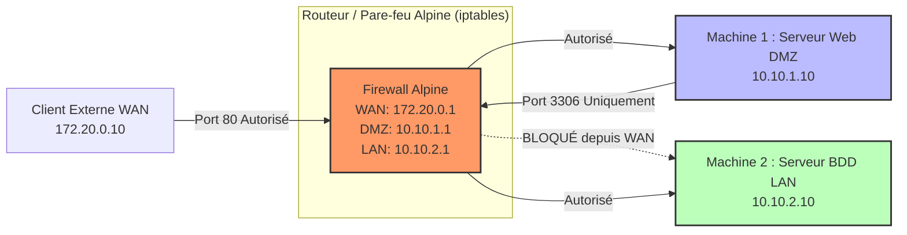

Pour simuler une architecture avec **deux machines isolées par une DMZ (Zone Démilitarisée)** sous Docker avec **Alpine Linux**, le cœur de l'exercice consiste à configurer un conteneur **Pare-feu / Routeur** équipé de trois interfaces réseau distinctes et de règles `iptables` strictes.

---

### 1. Topologie de l'architecture avec DMZ

Le schéma ci-dessous illustre le cloisonnement :

* **WAN (Externe) :** Simule Internet ou un client externe (`172.20.0.10`).
* **DMZ :** Héberge le serveur exposé au public (`10.10.1.10`, ex. : serveur Web Nginx).
* **LAN (Interne) :** Héberge la machine sensible (`10.10.2.10`, ex. : base de données).



**Règles de sécurité appliquées par le pare-feu :**

1. **WAN $\rightarrow$ DMZ :** Autorisé uniquement sur le port HTTP (80).
2. **WAN $\rightarrow$ LAN :** Strictement interdit (bloqué par défaut).
3. **DMZ $\rightarrow$ LAN :** Autorisé uniquement vers le port de base de données (ex. : 3306) pour que le serveur web interroge la base, mais le ping (ICMP) ou le SSH sont bloqués.
4. **LAN $\rightarrow$ DMZ / WAN :** Autorisé (pour les mises à jour ou l'administration).

---

### 2. Déploiement avec Docker Compose

Crée un fichier `docker-compose.yml` qui monte les trois réseaux isolés, le pare-feu et les deux machines cibles (plus un client externe pour tester) :

```yaml
services:
  # --- PARE-FEU / ROUTEUR CENTRAL ---
  firewall:
    image: alpine:latest
    container_name: firewall
    cap_add:
      - NET_ADMIN
    command: >
      /bin/sh -c "
      apk add --no-cache iproute2 iptables &&
      sysctl -w net.ipv4.ip_forward=1 &&
      tail -f /dev/null"
    networks:
      wan_net:
        ipv4_address: 172.20.0.1
      dmz_net:
        ipv4_address: 10.10.1.1
      lan_net:
        ipv4_address: 10.10.2.1

  # --- CLIENT EXTERNE (SIMULE INTERNET) ---
  wan_client:
    image: alpine:latest
    container_name: wan_client
    cap_add:
      - NET_ADMIN
    command: >
      /bin/sh -c "
      apk add --no-cache iproute2 iputils curl &&
      ip route replace default via 172.20.0.1 &&
      tail -f /dev/null"
    networks:
      wan_net:
        ipv4_address: 172.20.0.10

  # --- MACHINE 1 : SERVEUR WEB EN DMZ ---
  web_dmz:
    image: alpine:latest
    container_name: web_dmz
    cap_add:
      - NET_ADMIN
    command: >
      /bin/sh -c "
      apk add --no-cache iproute2 iputils nginx netcat-openbsd &&
      ip route replace default via 10.10.1.1 &&
      mkdir -p /run/nginx &&
      echo '<h1>Bienvenue sur le serveur Web en DMZ</h1>' > /var/www/localhost/htdocs/index.html &&
      nginx &&
      tail -f /dev/null"
    networks:
      dmz_net:
        ipv4_address: 10.10.1.10

  # --- MACHINE 2 : SERVEUR SENSIBLE EN LAN ---
  db_lan:
    image: alpine:latest
    container_name: db_lan
    cap_add:
      - NET_ADMIN
    command: >
      /bin/sh -c "
      apk add --no-cache iproute2 iputils netcat-openbsd &&
      ip route replace default via 10.10.2.1 &&
      while true; do echo 'Donnees confidentielles BDD' | nc -l -p 3306; done"
    networks:
      lan_net:
        ipv4_address: 10.10.2.10

networks:
  wan_net:
    driver: bridge
    ipam:
      config:
        - subnet: 172.20.0.0/24
  dmz_net:
    driver: bridge
    ipam:
      config:
        - subnet: 10.10.1.0/24
  lan_net:
    driver: bridge
    ipam:
      config:
        - subnet: 10.10.2.0/24

```

Lance l'environnement :

```bash
docker compose up -d

```

---

### 3. Configuration des règles du Pare-feu (`iptables`)

Par défaut, Linux transfère tout le trafic entre ses interfaces dès que `ip_forward=1` est actif. Nous allons verrouiller le pare-feu avec une politique **DROP** (tout bloquer par défaut) et n'ouvrir que les flux légitimes.

Exécute ces commandes sur le conteneur `firewall` :

```bash
# 1. Politique par défaut : on bloque tout le trafic qui traverse le routeur (FORWARD)
docker exec firewall iptables -P FORWARD DROP

# 2. Autoriser les réponses aux connexions déjà établies (Stateful firewall)
docker exec firewall iptables -A FORWARD -m state --state ESTABLISHED,RELATED -j ACCEPT

# 3. Autoriser le WAN (172.20.0.0/24) à joindre UNIQUEMENT le port 80 de la DMZ (10.10.1.10)
docker exec firewall iptables -A FORWARD -s 172.20.0.0/24 -d 10.10.1.10 -p tcp --dport 80 -j ACCEPT

# 4. Autoriser la DMZ (10.10.1.10) à joindre UNIQUEMENT le port 3306 du LAN (10.10.2.10)
docker exec firewall iptables -A FORWARD -s 10.10.1.10 -d 10.10.2.10 -p tcp --dport 3306 -j ACCEPT

# 5. Autoriser le LAN (10.10.2.0/24) à initier des connexions vers la DMZ ou le WAN (ex: admin, mises à jour)
docker exec firewall iptables -A FORWARD -s 10.10.2.0/24 -j ACCEPT

```

---

### 4. Tests de validation du cloisonnement

Tu peux maintenant vérifier que la DMZ joue parfaitement son rôle de sas de sécurité :

**Test 1 : Accès au site web en DMZ depuis l'extérieur (Doit réussir)**

```bash
docker exec wan_client curl -s http://10.10.1.10
# Résultat attendu : <h1>Bienvenue sur le serveur Web en DMZ</h1>

```

**Test 2 : Tentative d'accès direct au serveur LAN depuis l'extérieur (Doit échouer)**

```bash
docker exec wan_client ping -c 2 -W 1 10.10.2.10
# Résultat attendu : 100% packet loss (bloqué par le pare-feu)

```

**Test 3 : Communication légitime entre le serveur Web (DMZ) et la BDD (LAN) (Doit réussir)**

```bash
docker exec web_dmz nc -w 2 10.10.2.10 3306
# Résultat attendu : Donnees confidentielles BDD

```

**Test 4 : Tentative de ping depuis la DMZ vers le LAN (Doit échouer)**
*(Si le serveur web en DMZ est piraté, l'attaquant ne peut pas scanner le réseau interne)*

```bash
docker exec web_dmz ping -c 2 -W 1 10.10.2.10
# Résultat attendu : 100% packet loss

```

### Exercice système
1. Ajouter un utlisateur à une machine
2. Visualiser la liste des utilisateurs
3. Ajouter un fichier readme dans le home de cet utilisateur.

### Correction

Entrer dans le conteneur `db_lan` avec un shell :

```bash
docker exec -ti db_lan sh
```

Puis, depuis le shell du conteneur Alpine, créer l'utilisateur `alice`, afficher les utilisateurs et créer son fichier `readme` :

```sh
adduser -D alice
cat /etc/passwd
echo "Fichier readme d'alice" > /home/alice/readme
ls -l /home/alice/readme
exit
```

