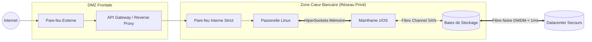
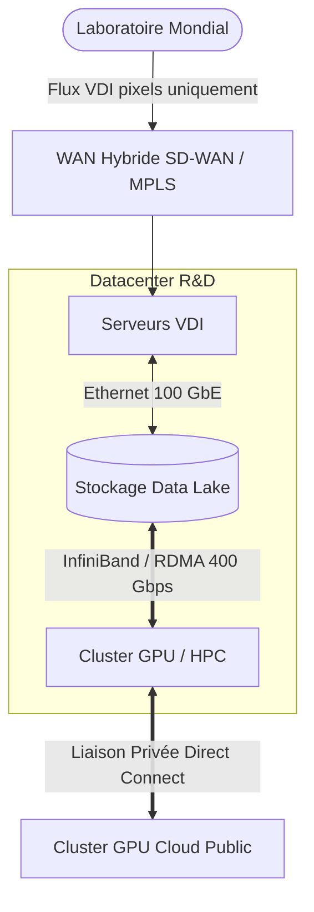
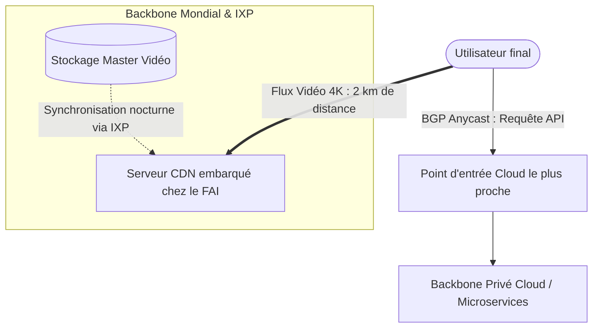
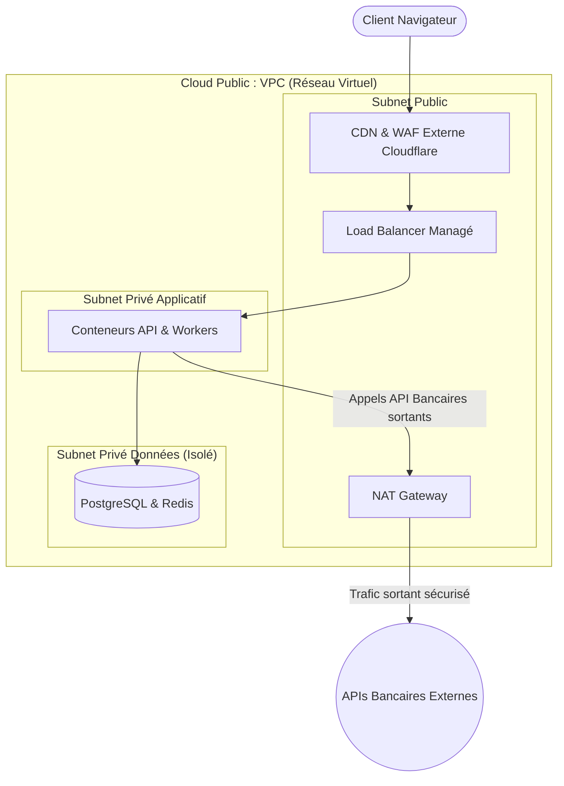

Pour chacun de ces quatre contextes, la topologie réseau, les protocoles et les équipements déployés répondent à des impératifs très différents (latence, débit, cloisonnement ou simplicité).

---

### 1. Le Mainframe bancaire : Réseau ultra-cloisonné à très faible latence

* **Type d'infrastructure :** Réseau d'entreprise privé (**WAN MPLS** ou **SD-WAN** dédié) reliant les agences et datacenters, couplé à un réseau interne haute vitesse (**SAN** / *Storage Area Network* en Fibre Channel) et des bus internes dédiés au mainframe (**HiperSockets**).
* **Caractéristiques clés :**
* **Segmentation stricte (Zero Trust / DMZ multiples) :** Le mainframe n'est jamais exposé directement à Internet. Le trafic traverse plusieurs zones démilitarisées (DMZ) filtrées par des pare-feux matériels de nouvelle génération (NGFW) et des systèmes de détection d'intrusion (IDS/IPS).
* **Bus mémoire interne (HiperSockets) :** Pour les échanges entre le serveur d'intégration Linux (LinuxONE) et le cœur z/OS sur la même machine physique, les paquets transitent directement en mémoire vive à la vitesse du silicium, sans passer par une carte réseau physique.
* **Liaisons inter-datacenters (DWDM) :** Les deux datacenters (actif/secours) sont reliés par des fibres optiques noires dédiées utilisant le multiplexage en longueur d'onde (DWDM) pour garantir la réplication synchrone des données avec une latence inférieure à la milliseconde.

---

### 2. La R&D d'un géant industriel : Réseau hybride à très haut débit (HPC)

* **Type d'infrastructure :** Réseau local haute performance (**InfiniBand** ou **Ethernet 100/400 GbE** avec **RDMA**) au sein des datacenters de calcul, interconnecté aux laboratoires mondiaux via un **WAN hybride** (MPLS + VPN IPsec sur Internet) et des liaisons directes vers le Cloud (**AWS Direct Connect / Azure ExpressRoute**).
* **Caractéristiques clés :**
* **Interconnexion faible latence (InfiniBand / RoCE) :** Dans un cluster GPU/HPC, les nœuds doivent s'échanger des milliards de paramètres en permanence. Le protocole RDMA (*Remote Direct Memory Access*) permet à un serveur de lire/écrire directement dans la RAM d'un autre serveur sans solliciter le processeur (CPU), évitant tout goulot d'étranglement.
* **Basculement vers le Cloud (*Cloud Bursting*) :** Lorsque les clusters internes sont saturés par une simulation complexe, des liaisons privées dédiées (10 à 100 Gbps) étendent le réseau local vers le cloud public pour louer temporairement de la puissance de calcul.
* **Flux déportés (VDI) :** Les stations de travail virtuelles des chercheurs utilisent des protocoles d'affichage optimisés (PCoIP, Blast) qui ne font transiter sur le réseau mondial que les pixels modifiés à l'écran, protégeant ainsi les gigaoctets de données brutes de tout téléchargement local.

---

### 3. Une plateforme de VOD mondiale : Réseau distribué Edge et routage Anycast

* **Type d'infrastructure :** Infrastructure réseau massivement distribuée reposant sur le protocole **BGP Anycast**, un réseau de diffusion de contenu propriétaire (**CDN / Edge Network**) et des interconnexions directes (**Peering**) au cœur des réseaux des opérateurs télécoms.
* **Caractéristiques clés :**
* **Routage BGP Anycast :** Toutes les passerelles d'entrée partagent la même adresse IP publique mondiale. Le routage Internet (BGP) dirige automatiquement chaque utilisateur vers le point d'entrée géographiquement et topologiquement le plus proche.
* **Peering direct et serveurs embarqués :** Plutôt que de payer un transit Internet coûteux sur de longues distances, la plateforme installe ses serveurs de cache (Open Connect) directement dans les points d'échange Internet (**IXP**) et dans les locaux techniques des FAI (Orange, Free, Comcast...). Le flux vidéo parcourt ainsi quelques kilomètres au lieu de traverser un océan.
* **Réseaux virtuels Cloud (VPC) multi-régions :** La partie contrôle (catalogue, comptes) tourne sur des réseaux virtuels isolés dans plusieurs régions cloud mondiales, interconnectés par le backbone privé du fournisseur cloud (AWS/GCP) pour une résilience totale.

---

### 4. Un petit SaaS FinTech : Réseau virtuel managé (VPC Cloud)

* **Type d'infrastructure :** Réseau défini par logiciel (**SDN**) au sein d'un fournisseur Cloud public, structuré autour d'un **VPC** (*Virtual Private Cloud*) découpé en sous-réseaux publics et privés, sans aucun matériel réseau physique à administrer.
* **Caractéristiques clés :**
* **Isolation par sous-réseaux (*Subnets*) :**
* *Subnet Public :* Contient uniquement le Load Balancer / Reverse Proxy exposé à Internet.
* *Subnet Privé Applicatif :* Contient les conteneurs applicatifs et les *workers*. Ils n'ont pas d'adresse IP publique et ne sont joignables que par le Load Balancer.
* *Subnet Privé Données :* Contient la base de données PostgreSQL et Redis, accessibles uniquement depuis le sous-réseau applicatif via des règles de pare-feu virtuels (*Security Groups*).

* **Passerelle NAT (*NAT Gateway*) :** Permet aux conteneurs privés d'initier des connexions sortantes vers Internet (par exemple pour interroger l'API d'un agrégateur bancaire comme Budget Insight ou Tink) tout en bloquant toute connexion entrante non sollicitée.
* **DNS Managé & CDN léger :** Un service comme Cloudflare se place devant le VPC pour absorber les attaques DDoS, gérer les certificats SSL/TLS et mettre en cache les fichiers statiques du front-end.

---

### Tableau récapitulatif des topologies réseau

| Contexte | Architecture réseau dominante | Technologies / Protocoles clés | Philosophie de sécurité |
| --- | --- | --- | --- |
| **Banque** | Réseau privé physique & virtuel fermé | MPLS, Fibre Channel, DWDM, HiperSockets | Cloisonnement périmétrique extrême et chiffrement matériel |
| **R&D Industrielle** | Réseau haute performance (HPC) + Hybride | InfiniBand, RDMA, Ethernet 400G, Direct Connect | Débit maximal interne et confinement des données brutes |
| **VOD Mondiale** | Réseau Edge distribué mondialement | BGP Anycast, Peering IXP, CDN propriétaire | Proximité physique avec l'utilisateur et absorption de charge |
| **Petit SaaS FinTech** | Réseau virtuel Cloud (VPC / SDN) | Subnets privés, Security Groups, NAT Gateway, WAF | Délégation de l'infrastructure et isolation logique par couches |

Voici un lexique complet des acronymes utilisés depuis le début de nos échanges, classés par thématique et expliqués simplement avec des analogies concrètes.

---

### 1. Haute disponibilité et contrats (SLA)

* **HA (*High Availability* — Haute Disponibilité) :** Capacité d'un système informatique à rester accessible presque sans interruption, même si un serveur tombe en panne. *Analogie : Avoir une roue de secours prête à se monter toute seule dès qu'un pneu crève.*
* **SPOF (*Single Point of Failure* — Point Unique de Défaillance) :** Tout composant d'une architecture dont la panne entraîne l'arrêt complet du service. *Exemple : Un seul câble d'alimentation ou un seul routeur pour tout un immeuble.*
* **SLA (*Service Level Agreement* — Accord de Niveau de Service) :** Contrat qui engage un fournisseur sur la qualité de son service (ex. : disponible 99,9 % du temps), avec des pénalités financières s'il ne respecte pas sa promesse.
* **GTI (Garantie de Temps d'Intervention) :** Temps maximum que met un technicien pour **commencer** à s'occuper d'une panne après l'alerte.
* **GTR (Garantie de Temps de Rétablissement) :** Temps maximum pour **réparer** la panne et remettre le service en marche.
* **RPO (*Recovery Point Objective* — Perte de données maximale admissible) :** Quantité maximale de données récentes qu'on accepte de perdre en cas de crash. Si le RPO est de 15 minutes, on sauvegarde toutes les 15 minutes.
* **RTO (*Recovery Time Objective* — Temps d'interruption maximal admissible) :** Durée maximale pendant laquelle l'entreprise accepte que son système soit hors service après un gros sinistre.

---

### 2. Architecture serveurs, stockage et calcul

* **HPC (*High-Performance Computing* — Calcul Haute Performance) :** Regroupement de centaines ou milliers de serveurs ultra-puissants qui travaillent ensemble comme un seul supercalculateur pour résoudre des problèmes complexes (météo, chimie, IA).
* **GPU (*Graphics Processing Unit* — Processeur Graphique) :** À l'origine conçu pour l'affichage des jeux vidéo, c'est une puce capable de faire des milliers de petits calculs en même temps. Indispensable aujourd'hui pour entraîner les intelligences artificielles.
* **CPU (*Central Processing Unit* — Processeur Central) :** Le « cerveau » classique d'un serveur. Très rapide pour exécuter des tâches complexes les unes après les autres, contrairement au GPU qui fait du calcul massif en parallèle.
* **NVMe (*Non-Volatile Memory Express*) :** Technologie de disque SSD ultra-rapide branchée directement sur la carte mère, capable de lire et écrire des données à plusieurs gigaoctets par seconde.
* **NAS (*Network Attached Storage* — Stockage en Réseau) :** Serveur dédié uniquement au stockage de fichiers, accessible par tous les autres ordinateurs du réseau comme un disque dur partagé géant.
* **SAN (*Storage Area Network* — Réseau de Stockage) :** Réseau ultra-rapide et isolé reliant directement des serveurs à d'énormes baies de disques durs. Pour le serveur, ces disques distants apparaissent comme s'ils étaient branchés à l'intérieur de sa propre tour.
* **VDI (*Virtual Desktop Infrastructure* — Infrastructure de Bureaux Virtuels) :** Système où votre ordinateur (Windows/Linux) tourne en réalité sur un serveur dans un datacenter. Votre écran ne reçoit que l'image à distance ; aucune donnée sensible n'est stockée sur votre PC portable.

---

### 3. Logiciel, Cloud et bases de données

* **SaaS (*Software as a Service* — Logiciel en tant que Service) :** Logiciel hébergé dans le cloud auquel on accède simplement via un navigateur web avec un abonnement (ex. : Gmail, Netflix, Salesforce), sans rien installer.
* **PaaS (*Platform as a Service* — Plateforme en tant que Service) :** Service cloud où le fournisseur gère les serveurs, le système d'exploitation et les mises à jour ; le développeur n'a plus qu'à déposer son code pour qu'il tourne.
* **DBaaS (*Database as a Service* — Base de Données en tant que Service) :** Base de données hébergée et maintenue automatiquement par un fournisseur cloud (sauvegardes, réplication et sécurité gérées sans administrateur).
* **API (*Application Programming Interface* — Interface de Programmation) :** Point d'entrée permettant à deux logiciels de dialoguer et d'échanger des données automatiquement. *Analogie : Le serveur au restaurant qui prend votre commande et la transmet à la cuisine.*
* **ESB (*Enterprise Service Bus* — Bus de Services d'Entreprise) :** Logiciel central qui joue le rôle de « traducteur » et d'aiguilleur entre de vieilles applications (comme un mainframe) et des applications modernes.
* **PLM (*Product Lifecycle Management* — Gestion du Cycle de Vie des Produits) :** Logiciel collaboratif utilisé par les industriels pour suivre un produit de sa première idée en laboratoire jusqu'à sa fabrication et sa mise en vente.
* **ACID (*Atomicité, Cohérence, Isolation, Durabilité*) :** Quatre règles garantissant qu'une transaction informatique est 100 % fiable. En banque, cela garantit que si un virement échoue en cours de route, l'argent n'est pas débité d'un compte sans être crédité sur l'autre.
* **JWT (*JSON Web Token*) :** Badge d'accès numérique chiffré donné à un utilisateur après sa connexion. Il le présente à chaque requête pour prouver qui il est, évitant aux serveurs d'avoir à garder sa session en mémoire.
* **CI/CD (*Continuous Integration / Continuous Deployment* — Intégration et Déploiement Continus) :** Chaîne automatisée qui teste le code écrit par les développeurs et le met en ligne sur les serveurs sans intervention humaine.

---

### 4. Réseau et infrastructure télécom

* **DNS (*Domain Name System* — Système de Noms de Domaine) :** L'annuaire d'Internet. Il traduit un nom lisible par l'humain (ex. : `netflix.com`) en une adresse IP numérique compréhensible par les machines.
* **VIP (*Virtual IP* — Adresse IP Virtuelle) :** Adresse IP qui n'est pas fixée à une seule machine physique, mais qui peut basculer instantanément d'un serveur à un autre si le premier tombe en panne.
* **VRRP (*Virtual Router Redundancy Protocol*) :** Protocole réseau permettant à deux routeurs (ou répartiteurs de charge) de se surveiller en permanence pour que le second reprenne l'adresse VIP du premier en moins d'une seconde en cas de crash.
* **CDN (*Content Delivery Network* — Réseau de Diffusion de Contenu) :** Réseau de serveurs répartis partout dans le monde qui gardent en cache des copies de fichiers lourds (vidéos, images) pour les livrer depuis un endroit tout proche de l'utilisateur.
* **IXP (*Internet Exchange Point* — Point d'Échange Internet) :** Bâtiment physique ultra-sécurisé où les grands opérateurs télécoms (Orange, Free...) et les géants du web (Google, Netflix) branchent leurs câbles directement ensemble pour échanger du trafic sans intermédiaire.
* **BGP (*Border Gateway Protocol*) :** Le « GPS » d'Internet. C'est le protocole qui permet aux grands réseaux mondiaux de savoir quel est le meilleur chemin pour acheminer des données d'un pays à un autre.
* **WAN (*Wide Area Network* — Réseau Étendu) :** Réseau informatique couvrant une grande distance géographique (reliant plusieurs villes ou pays entre eux).
* **MPLS (*Multiprotocol Label Switching*) :** Technologie de réseau privé fournie par les opérateurs télécoms permettant de relier les agences d'une entreprise avec une qualité garantie et isolée d'Internet.
* **SD-WAN (*Software-Defined WAN*) :** Version moderne et intelligente du réseau d'entreprise qui pilote automatiquement le trafic sur plusieurs connexions (fibre pro, 5G, Internet classique) selon l'urgence et la qualité de chaque ligne.
* **SDN (*Software-Defined Networking* — Réseau Défini par Logiciel) :** Technologie permettant de créer et configurer des réseaux entiers (routeurs, câbles, pare-feux) uniquement par du code informatique, sans toucher à du matériel physique.
* **VPC (*Virtual Private Cloud* — Cloud Privé Virtuel) :** Votre propre quartier privé et clôturé à l'intérieur d'un grand cloud public (comme AWS ou Azure), totalement isolé des autres clients.
* **NAT (*Network Address Translation* — Traduction d'Adresse Réseau) :** Mécanisme permettant à des serveurs privés (cachés sans adresse IP publique) de sortir sur Internet pour télécharger des mises à jour ou appeler des APIs, tout en empêchant Internet d'entrer chez eux.
* **DWDM (*Dense Wavelength Division Multiplexing*) :** Technologie optique permettant de faire passer des dizaines de faisceaux laser de couleurs différentes dans un seul brin de fibre optique pour multiplier son débit à l'infini.
* **RDMA (*Remote Direct Memory Access*) :** Technologie réseau ultra-rapide permettant à un serveur d'écrire directement dans la mémoire RAM d'un autre serveur voisin sans déranger son processeur.
* **VoD (*Video on Demand* — Vidéo à la Demande) :** Service permettant de regarder des vidéos quand on le souhaite (streaming), par opposition à la télévision traditionnelle avec horaires fixes.

---

### 5. Cybersécurité et conformité

* **DMZ (*Demilitarized Zone* — Zone Démilitarisée) :** Sas de sécurité réseau placé entre Internet et le réseau interne de l'entreprise. Les serveurs exposés au public y sont placés : s'ils sont piratés, l'attaquant reste bloqué dans le sas et n'atteint pas le cœur du système.
* **WAF (*Web Application Firewall* — Pare-feu Applicatif Web) :** Bouclier spécialisé qui analyse le contenu des requêtes web pour bloquer les piratages visant les sites internet (injections SQL, robots malveillants).
* **DDoS (*Distributed Denial of Service* — Attaque par Déni de Service Distribué) :** Attaque informatique consistant à submerger un serveur de millions de fausses demandes simultanées pour le saturer et le rendre inaccessible aux vrais utilisateurs.
* **NGFW (*Next-Generation Firewall* — Pare-feu de Nouvelle Génération) :** Pare-feu intelligent capable non seulement de bloquer des adresses IP ou des ports, mais aussi d'inspecter le contenu réel des données qui circulent pour repérer des virus cachés.
* **IDS / IPS (*Intrusion Detection / Prevention System*) :** « Alarme anti-intrusion » du réseau. L'IDS détecte une activité suspecte et prévient l'administrateur ; l'IPS bloque immédiatement l'attaque tout seul.
* **HSM (*Hardware Security Module* — Module Matériel de Sécurité) :** Coffre-fort électronique inviolable (boîtier physique dédié) qui génère, stocke et utilise les clés secrètes de chiffrement bancaire. S'il est ouvert de force, il s'autodétruit logiquement.
* **SSL / TLS (*Secure Sockets Layer / Transport Layer Security*) :** Protocoles de chiffrement qui sécurisent les échanges sur Internet (le petit cadenas `https://` dans votre navigateur). TLS est le successeur moderne de SSL.
* **EMV (*Europay Mastercard Visa*) :** Norme internationale de sécurité régissant les paiements par carte à puce et sans contact.
* **RGPD (Règlement Général sur la Protection des Données) :** Loi européenne encadrant la collecte, le stockage et la protection des données personnelles des citoyens.
* **DSP2 (Directive sur les Services de Paiement 2) :** Loi européenne obligeant les banques à ouvrir l'accès sécurisé aux comptes (via API) aux acteurs FinTech agréés, et imposant l'authentification forte lors des paiements en ligne.

L'**Anycast** est une technique de routage et d'adressage réseau qui permet à **plusieurs serveurs situés à des endroits différents de partager une seule et même adresse IP**.

Pour comprendre l'Anycast, le plus simple est de le comparer aux autres modes de routage :

* **Unicast (le mode classique) :** Une adresse IP = un seul serveur précis. Quand vous vous connectez à un site, vos paquets de données vont tout droit vers cette machine unique, qu'elle soit à côté de chez vous ou à l'autre bout de la planète.
* **Broadcast :** Une adresse envoie un message à *toutes* les machines d'un même réseau local (comme crier un message à tout le monde dans une pièce).
* **Multicast :** Un message est envoyé à un groupe spécifique de machines abonnées.
* **Anycast :** Une adresse IP est annoncée au monde entier depuis plusieurs points géographiques. Lorsqu'un utilisateur l'appelle, **les routeurs d'Internet décident automatiquement de l'envoyer vers le serveur Anycast le plus proche** (en termes de topologie réseau).
