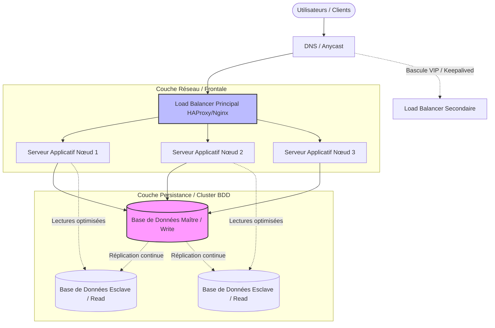

L'analyse d'une architecture multi-serveurs et de la logique de clustering repose sur des principes fondamentaux d'ingénierie logicielle et d'infrastructure répartie. L'objectif ultime est d'atteindre une **Haute Disponibilité (High Availability - HA)**, garantissant qu'un système reste opérationnel et accessible malgré les pannes matérielles, logicielles ou réseau.

---

### 1. Définition des concepts clés de la Haute Disponibilité

La haute disponibilité ne se résume pas à un simple serveur puissant ; elle s'articule autour de trois piliers indissociables :

* **Disponibilité (Availability) :**
C'est la mesure de la capacité d'un système à rester accessible et fonctionnel lorsqu'on en a besoin. Elle se calcule généralement en pourcentage de temps de bon fonctionnement (uptime) sur une période donnée. On vise souvent la norme des « cinq 9 » ($99{,}999\ \%$), ce qui autorise un cumul d'interruptions de seulement 5 minutes et 26 secondes par an.

$$\text{Disponibilité} = \frac{\text{Temps total} - \text{Temps d'indisponibilité}}{\text{Temps total}} \times 100$$

* **Redondance (Redundancy) :**
C'est le principe d'ajouter des composants matériels ou logiciels en double (ou plus) au sein de l'infrastructure pour éliminer tout **SPOF** (*Single Point of Failure* ou point unique de défaillance). Si un composant tombe en panne, un composant redondant prend immédiatement le relais.
* *Exemple :* Disposer de deux alimentations sur un serveur, de deux routeurs réseau, ou de plusieurs instances de serveurs web derrière un répartiteur de charge.

* **Réplication (Replication) :**
C'est le mécanisme technique permettant de copier et de synchroniser l'état et les données d'un système vers un ou plusieurs autres nœuds de secours. Elle peut être **synchrone** (la transaction est validée uniquement lorsque tous les nœuds ont écrit la donnée, garantissant zéro perte mais avec une latence accrue) ou **asynchrone** (le nœud principal valide immédiatement, puis propage en arrière-plan, offrant de meilleures performances mais un risque minime de perte de données en cas de panne brutale).

---

### 2. Schéma d'architecture multi-serveurs et clustering

Le schéma ci-dessous illustre une architecture web multi-serveurs classique hautement disponible, intégrant une zone frontale (load balancing), un cluster applicatif et une couche de persistance répliquée.

---

### 3. Analyse de la logique de clustering et des flux

#### A. Le point d'entrée et la tolérance aux pannes réseau

* **Load Balancer (Répartiteur de charge) :** Il distribue le trafic entrant entre les différents serveurs applicatifs selon des algorithmes (Round Robin, Least Connections, IP Hash).
* **Haute disponibilité du Load Balancer :** Puisque le Load Balancer lui-même pourrait devenir un SPOF, on utilise une configuration en binôme (Actif/Passif) couplée à une adresse IP virtuelle (VIP) gérée par des protocoles comme **VRRP** (via *Keepalived*). Si le répartiteur principal cesse d'émettre des battements de cœur (*heartbeats*), le secondaire s'approprie instantanément l'IP virtuelle.

#### B. Le cluster applicatif (Actif / Actif)

* Les serveurs applicatifs (Nœuds 1, 2, 3) fonctionnent en mode **Actif / Actif**. Ils traitent tous les requêtes simultanément.
* **Stateless vs Stateful :** Pour qu'un cluster applicatif soit performant, les applications doivent idéalement être *Stateless* (sans état de session stocké localement en mémoire vive). Les sessions utilisateurs sont déportées dans un service de cache partagé et répliqué (type Redis ou Memcached) ou gérées via des jetons sécurisés (JWT).

#### C. Le cluster de données (Maître / Esclave ou Master / Replica)

* La gestion de la base de données est le défi le plus complexe en haute disponibilité en raison de la persistance des données.
* **Écriture (Write) :** Toutes les requêtes de modification (INSERT, UPDATE, DELETE) sont routées exclusivement vers le nœud **Maître** (*Master*).
* **Lecture (Read) :** Les requêtes de consultation (SELECT) peuvent être réparties sur les nœuds **Esclaves** (*Replicas*), ce qui allège considérablement la charge du Maître.
* **Failover (Bascule automatique) :** Si le nœud Maître tombe en panne, un orchestrateur (comme *Orchestrator* pour MySQL ou *Patroni* pour PostgreSQL) détecte la défaillance, promeut l'un des Esclaves au rang de Maître et reconfigure le réseau.